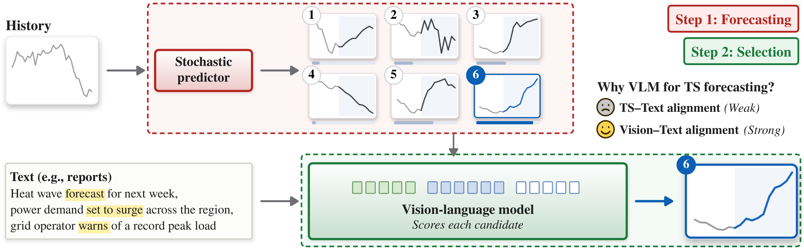
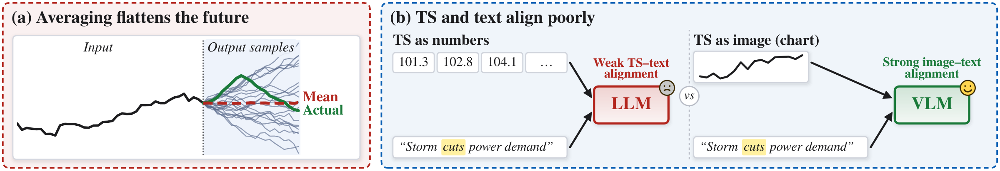
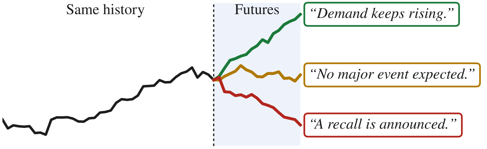
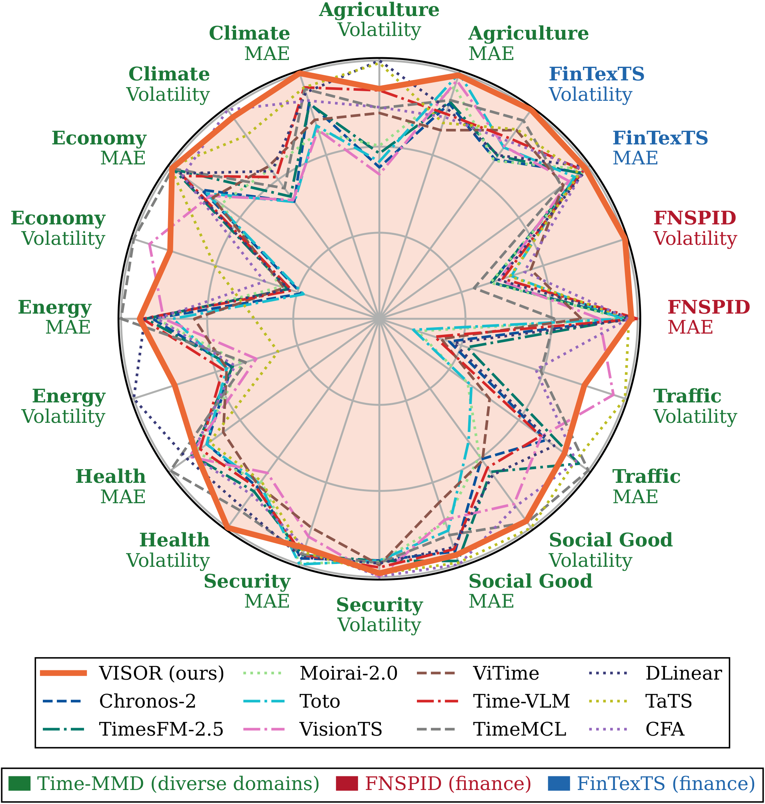
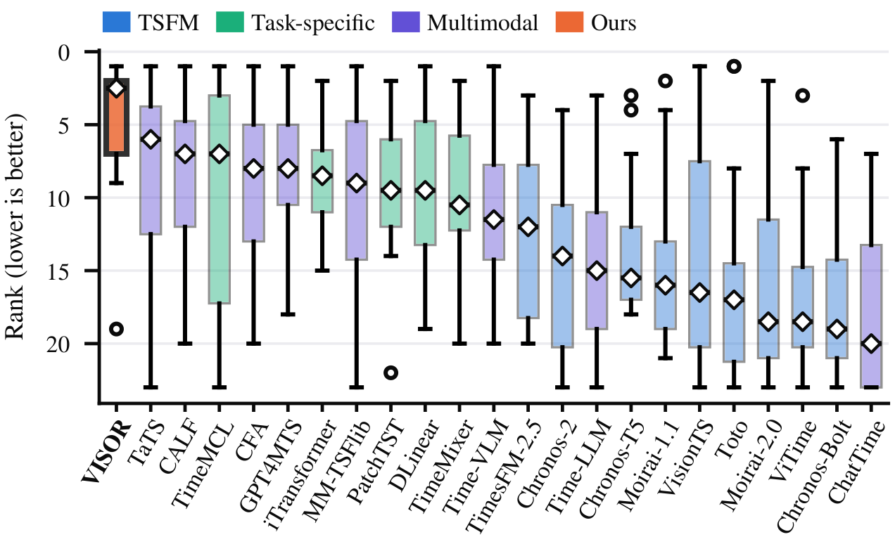
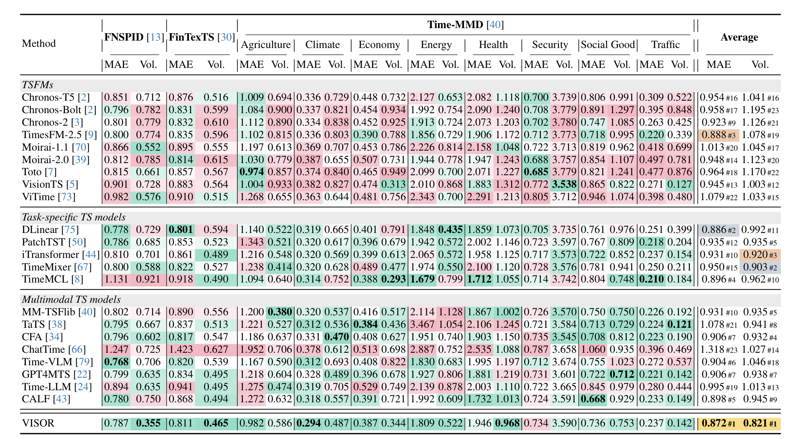
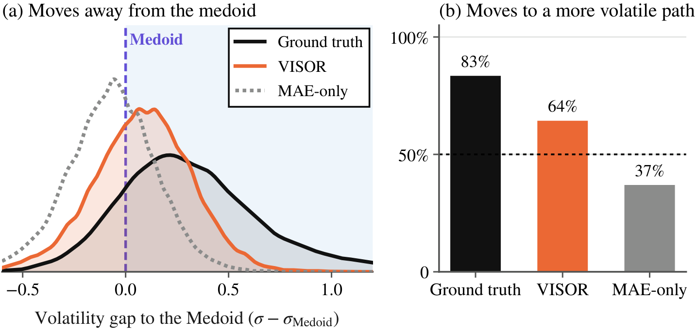
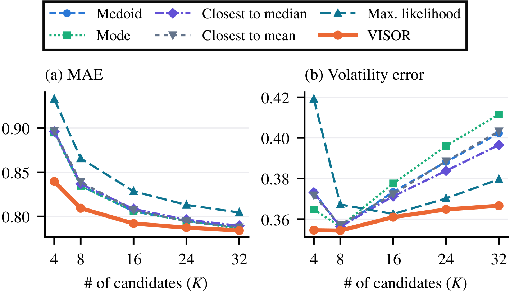
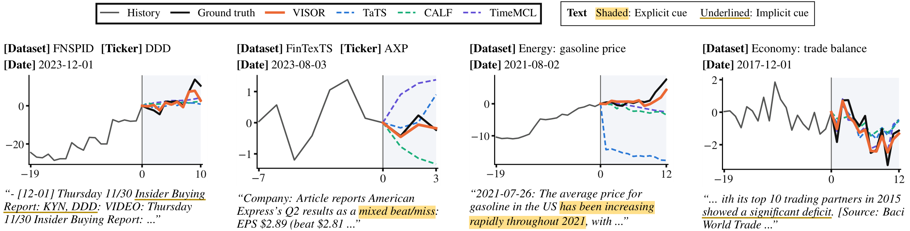

<div align="center">

# VISOR

### A Vision-Language Selector for Multimodal Time-Series Forecasting

*Multimodal time-series forecasting that samples diverse futures, draws them as a chart,<br>and lets a vision-language model pick one with the help of the paired text.*


</div>

<p align="center"></p>

## Overview

**Step 1, forecasting.** A text-free stochastic predictor samples K = 32 future paths from the history.
**Step 2, selection.** The history and the paths are drawn as one chart. A vision-language model (Qwen2.5-VL-3B with LoRA on the vision tower and the language model, plus a small scoring head) reads the chart together with the text and returns **one** sampled path.

- **Select one, never average.** The output is always one of the sampled paths, so it keeps the volatility of a real future.
- **Text only selects.** The predictor never sees the text, so noisy text cannot change the sampled values.
- **Shape-aware target.** The selector is trained with the point error plus a shape term (weight 0.1), which counters the calm-path bias of MAE-only selection.

### Why

<p align="center"></p>

(a) The mean or median of stochastic forecasts is a flat line that matches none of the futures. (b) VLMs read a plot of a series better than its numbers, while time series and text are weakly aligned. VISOR keeps the sampled futures and lets the VLM choose among them as images.

<p align="center"></p>

## Results

VISOR is compared with 22 baselines (9 TSFMs, 5 task-specific and 8 multimodal TS models) on FNSPID, FinTexTS and the eight Time-MMD datasets. Each Time-MMD dataset has its own predictor and selector and is reported on its own.

<p align="center">&nbsp;</p>

<p align="center"></p>
<p align="center"><sub>Test MAE and volatility error (lower is better). VISOR ranks first on average in both metrics.</sub></p>

<details>
<summary><b>Analyses</b> (calm-path bias, number of candidates, qualitative examples)</summary>
<br>
<p align="center">&nbsp;</p>
<p align="center"><sub>Left: an MAE-only selector moves to calmer paths than the truth, while VISOR moves toward the truth. Right: VISOR beats five training-free rules at every number of candidates K.</sub></p>
<p align="center"></p>
<p align="center"><sub>Selected test forecasts with the text that the selector read.</sub></p>
</details>

## Quick start

```bash
python -m venv .venv && . .venv/bin/activate
pip install -r requirements.txt

# print the full pipeline of one dataset (predictor, candidates, selector, test)
python scripts/run_config.py configs/fnspid.json

# run one step for one seed
python scripts/run_config.py configs/fnspid.json --step selector_train --seeds 0 --run
```

| Step | What it does | Entry point |
|---|---|---|
| 1 | Train the text-free predictor | `visor.kit_train` (FNSPID), `visor.fintexts` (FinTexTS), `visor.flow_mlp` / `visor.flow_mlp_prior` (Time-MMD) |
| 2 | Dump K = 32 candidate paths per row | `visor.kit_candidates`, or written by step 1 |
| 3 | Train and evaluate the VLM selector | `visor.selector` |
| 4 | Five seeds, mean of the three with the lowest validation target | `scripts/pick_seeds.py` |
| 5 | Paired tests clustered by forecast time | `scripts/paired_test.py` |

## Repository layout

```
visor/            the package
  selector.py     VLM selector: chart rendering, prompt, LoRA model, regression target, training and evaluation
  metrics.py      evaluator: MAE, MSE, endpoint, high/low, volatility and range errors, Frechet distance of shape features
  significance.py paired t-tests clustered by forecast time, per-row metrics, medoid
  kit_flow.py, kit_train.py, kit_candidates.py   FNSPID Chart-Native predictor (KiT-architecture canvas flow) and its candidates
  flow_mlp.py, flow_mlp_prior.py, fintexts.py    TS-to-Chart predictors (flow-matching MLP) and their candidates
  temperature.py, prior_candidate.py, pools.py   per-dataset candidate pools (temperature, prior path, slicing, CV pick)
  chart_native.py, chart_native_data.py          Chart-Native image predictor for FinTexTS and Time-MMD (design comparison)
  frozen_tsfm_candidates.py                      Frozen-TSFM design: TSFM samples as candidates
  paths.py        data and third-party locations (environment variables)
scripts/
  run_config.py   prints or runs the commands of a config
  pick_seeds.py   five seeds, mean over the three with the lowest validation target
  paired_test.py  paired test of two selector runs, or of a run against the medoid
  data/           data preparation and export of the evaluation rows for the baselines
configs/          the reported setting of each dataset (FNSPID, FinTexTS, 8 Time-MMD datasets) as ordered commands
baselines/        wrappers that run released baseline code on the same rows (third-party code is not included)
```

Run every command from the repository root. Generated files go to the working directory: `sel_dump/`, `mf_runs/`, `selector_runs/`, `results/`, `px_rows/` and `px_tsfm_out/`.

## Installation (details)

```
python -m venv .venv && . .venv/bin/activate
pip install -r requirements.txt
```

The selector downloads `Qwen/Qwen2.5-VL-3B-Instruct` from the Hugging Face hub. To run offline, put the model in the local cache first.

Third-party code is not shipped. Clone each repository and point to it with an environment variable.

| Variable | Repository | Used by |
|---|---|---|
| `KIT_ROOT` | KiT, https://github.com/Luciferbobo/KiT (AGPL-3.0) | FNSPID predictor architecture, features and normalization statistics (`$KIT_ROOT/ckpt/hf/stats.json` from its release) |
| `MMTSFLIB_ROOT` | MM-TSFlib, https://github.com/AdityaLab/MM-TSFlib | classic and multimodal baselines (TSLib backbones) |
| `TATS_DATA` | `data/` folder of TaTS, https://github.com/iDEA-iSAIL-Lab-UIUC/TaTS | TaTS baseline and the benchmark prior of Time-MMD (`prior_candidate.py`) |
| `CFA_ROOT` | released code of the CFA paper | CFA baseline |

## Data preparation

`VISOR_DATA` is the data root and defaults to `./data`. Each location can be set on its own (see `visor/paths.py`).

**FNSPID** (prices and news). Download the release into `$VISOR_DATA/raw/fnspid` (`Stock_price/full_history.zip`, `Stock_news/*.csv`), then run:
```
python scripts/data/build_fnspid.py        # daily candles, KiT features, trading calendar -> $VISOR_MEM/fnspid/1d, raw/
python scripts/data/build_fnspid_news.py   # news mapped to the first close after each article -> $VISOR_MEM/fnspid/news.parquet
```
`configs/fnspid_codes.txt` lists the 1,063 tickers used for the candidate rows.

**Time-MMD.** Put the MM-TSFlib copy of the eight datasets in `$VISOR_DATA/raw/time_mmd/mmtsflib/data/<Dataset>/*.csv`. Set `TATS_DATA` to the TaTS data folder, which holds the same rows with the `prior_history_avg` column.

The predictors use `--pre auto`, which pretrains on price windows dated before each dataset's validation period. Build these windows from FNSPID prices:
```
python scripts/data/make_stock_windows.py --freq M --cutoff 2010-10-31 --tag M2010
python scripts/data/make_stock_windows.py --freq M --cutoff 2002-05-31 --tag M2002
python scripts/data/make_stock_windows.py --freq W --cutoff 2015-10-23 --tag W2015
```

**FinTexTS.** Put the parquet files of the FinTexTS release in `$VISOR_DATA/fintexts_raw/data`.

## Reproducing the main experiments

Each config in `configs/` lists the steps of one dataset in order, with the exact flags of the reported runs. Print a config's commands with:
```
python scripts/run_config.py configs/fnspid.json
python scripts/run_config.py configs/fnspid.json --step selector_train --seeds 0 --run
```

### (a) Train the predictor

| Dataset | Command | Predictor |
|---|---|---|
| FNSPID | `python -m visor.kit_train --tag fg17_s0 --mode kit ... --train_end 2017-12-31` | trained on prices up to 2017. A second predictor, `fg21_s0`, uses prices up to 2021. Full flags: `configs/fnspid.json`. |
| FinTexTS | `python -m visor.fintexts --steps 20000 --width 256 --out fintexts` | one model over all tickers |
| Time-MMD | `python -m visor.flow_mlp --per_dom 1 --pre auto --width 512 ... --out <name>` | one model per dataset. Per-dataset settings: `configs/tmmd_<Dataset>.json`. Energy and Health use `python -m visor.flow_mlp_prior`. |

### (b) Dump the candidates

- **FNSPID.** Run `python -m visor.kit_candidates --ckpt mf_runs/fg17_s0.pt ... --part p/20` for each part of train (2018 to 2021), val (2022) and test (2023), using the `candidates_*` steps of the config.
- **FinTexTS and Time-MMD.** Training the predictor also writes the candidates: `sel_dump/<out>_{tr,va,te}.npz`.
  - `visor.pools slice` cuts the Time-MMD files per dataset.
  - `visor.temperature` changes the sampling temperature without retraining.
  - `visor.prior_candidate` adds the benchmark prior as a path.
  - `visor.pools cv` is the cross-validated choice of the predictor setting (Security, Social Good).

### (c) Train and evaluate the selector

```
python -m visor.selector --train "sel_dump/fsel_fnspid_tr_g17_p*.npz" --val "sel_dump/fsel_fnspid_va_g17_p*.npz" \
  --obj reg --prior 0 --yshare 1 --k_eval 32 --k 16 --mode line --img 224x112 --bs 8 --text news --news_clean 1 \
  --lora_vision 1 --aux 0.5 --val_rows 3000 --w_shape 0.1 --test_rows 4000 --eval_every 1000 --steps 6000 \
  --seed 0 --tag vt_3b_w_shape0.1
```

- **Saved files.** The best validation checkpoint goes to `selector_runs/<tag>.pt`, the scores of each split to `selector_runs/<tag>_<split>_scores.npz`, and all metrics to `results/<tag>.json`.
- **FNSPID test.** This is a separate run with `--load selector_runs/<tag>.pt --steps 0 --no_val 1`, on the 10,000 fixed test rows of both candidate sets (step `selector_test`).
- **FinTexTS and Time-MMD.** These selectors start from the FNSPID selector of seed 0 (`--load selector_runs/vt_3b_w_shape0.1.pt`) and are fine-tuned on each dataset.
- **Seeds.** Five seeds are trained. The paper reports the mean over the three with the lowest validation target:
  ```
  python scripts/pick_seeds.py vt_3b_w_shape0.1 --test_tag te3_vt_3b_w_shape0.1 --split te_g17
  python scripts/pick_seeds.py tmmdP_A_ftCPpri_Energy
  ```
- **Significance.** `python scripts/paired_test.py <dump glob> <scores_a.npz> [<scores_b.npz> | medoid]`

### (d) Baselines

Every baseline forecasts the same rows that VISOR is scored on. First export these rows:
```
python scripts/data/export_rows.py fnspid      # px_rows/fnspid_te23.npz
python scripts/data/export_rows.py tmmd        # px_rows/tmmd_{tr,va,te}.npz
python scripts/data/export_rows.py fintexts    # px_rows/fintexts_{tr,va,te}.npz
python scripts/data/export_rows_fnspid_trva.py # FNSPID train/val rows (Frozen-TSFM design only)
```

| Baseline | Command |
|---|---|
| TSFMs: Chronos-T5, Chronos-Bolt, Chronos-2, TimesFM-2.5, Moirai-1.1, Moirai-2.0, Toto | `python baselines/px_tsfm.py --family chronos\|timesfm\|moirai\|toto --model <hub id> --market fnspid_te23\|tmmd_te\|fintexts_te [--lh 12\|3] --tag <fxt\|tmfxt\|ftxfxt>_<name>`. Run each family in its own environment with its released package: `chronos-forecasting`, `timesfm`, `uni2ts`, `toto-ts`. |
| DLinear, PatchTST, iTransformer, TimeMixer | `python baselines/classic_ts.py --data fnspid\|fintexts\|tmmd --model <name>` |
| MM-TSFlib | `python baselines/mm_ts.py --data ... --model <backbone>` |
| TaTS | `python baselines/tats_ts.py --data ... --model <backbone>` |
| CFA | `python baselines/cfa_ts.py --data ... --model <backbone>` |
| zero-shot LLM ranker (appendix) | `python baselines/lafp_rank.py --ref <selector tag> --split te` |
| scoring of all outputs | `python baselines/score_baselines.py` writes `results/baselines_point.json` |

The following baselines are not included here, because running them needs a copy or a port of their own code: VisionTS, ViTime, TimeMCL, Time-VLM, GPT4MTS, Time-LLM, CALF and ChatTime. Use the original repositories with the rows exported above. Each baseline is scored on its point forecast, the per-step median of its output paths, with the evaluator of `visor/metrics.py`.

## Paper tables and figures (main body)

| Item | Source |
|---|---|
| Fig. 1 (overview), Fig. 2 (motivation), Fig. 3 (radar), Fig. 4 (toy example) | illustrations. Fig. 3 summarizes Table 5. |
| Table 1 (related work), Table 2 (predictor designs) | text tables |
| Table 3 (datasets) | data preparation above. The window counts are the row counts of the `sel_dump/*_{tr,va,te}.npz` files. |
| Table 4 (baselines) | `baselines/` |
| Table 5 (main results), Fig. 5 (ranks) | VISOR: the `selector` (FinTexTS, Time-MMD) or `selector_test` (FNSPID) step of each config, then `scripts/pick_seeds.py`. Baselines: section (d) and `baselines/score_baselines.py`. |
| Table 6 (effect of VLM selection) | the `random` and `medoid` rows and the selector row of `results/<tag>.json` (`visor/metrics.py` evaluate/report) |
| Table 7 (selection target) | selector with `--w_shape 0` (MAE only), `--w_ret 0.5`, `--w_shape 0.1`. See `ablations` in `configs/fnspid.json`. |
| Fig. 6 (calm-path bias) | per-row volatility of the chosen path vs. the medoid (`visor/significance.py` path_metrics) |
| Fig. 7 (number of candidates) | test runs with `--k_eval 4/8/16/24/32` |
| Fig. 8 (selected test forecasts) | test score files `selector_runs/<tag>_te*_scores.npz` with the candidate dumps |
| Table 8 (chart vs. number input) | selector with `--input num` |
| Table 9 (ablation of the chart reader) | `--lora_vision 0`, `--aux 0`, `--mode candle`, `--img 336x168`, `--band 1` |
| Fig. 9 (training efficiency vs. rank) | run time and trainable share of each method. Not scripted. |
| Predictor designs (Table 2, appendix) | `visor/chart_native.py`, `visor/frozen_tsfm_candidates.py`, and the TS-to-Chart configs |

The scripts that format the paper's tables and figures are not included. The commands above produce every number they read.

## License

See `LICENSE`. The license is to be decided. KiT is AGPL-3.0, which applies to the FNSPID predictor when it is run with KiT's code.
